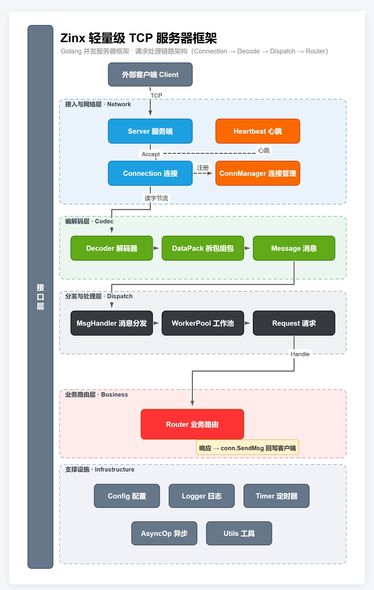
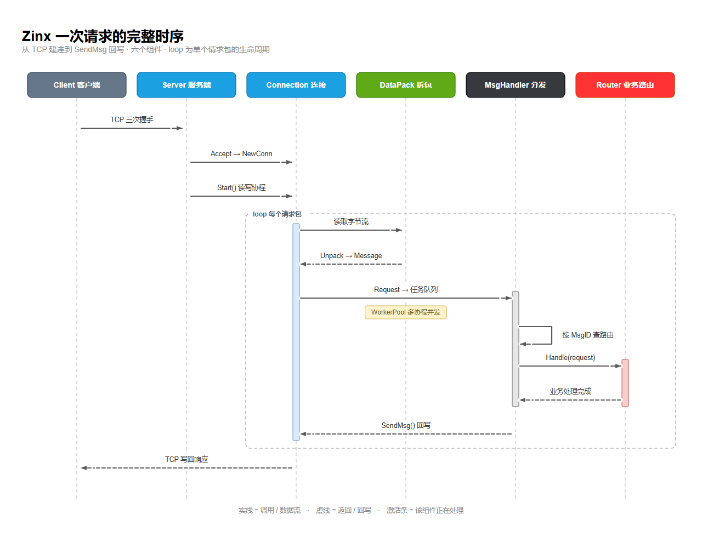
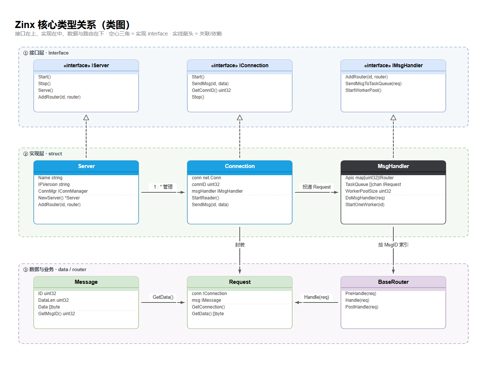
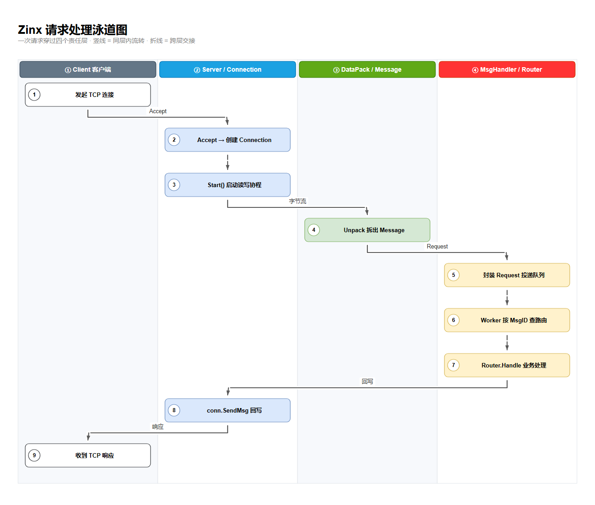
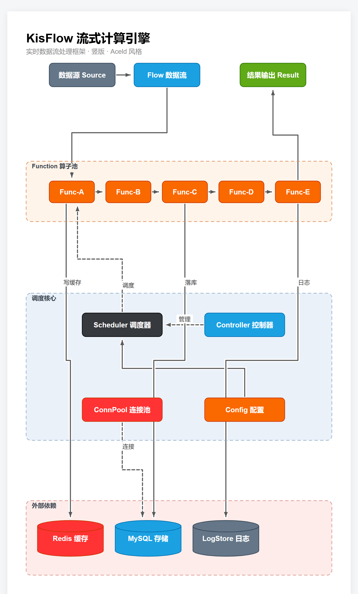
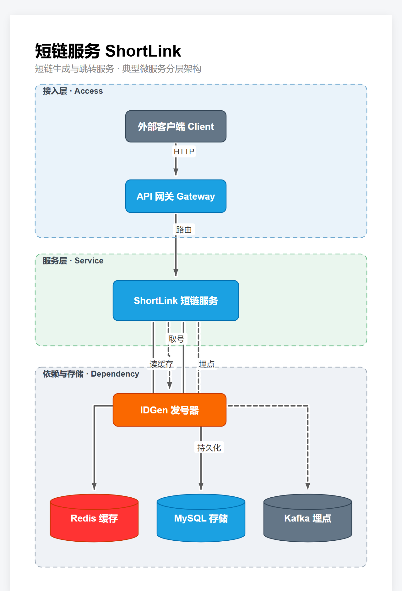
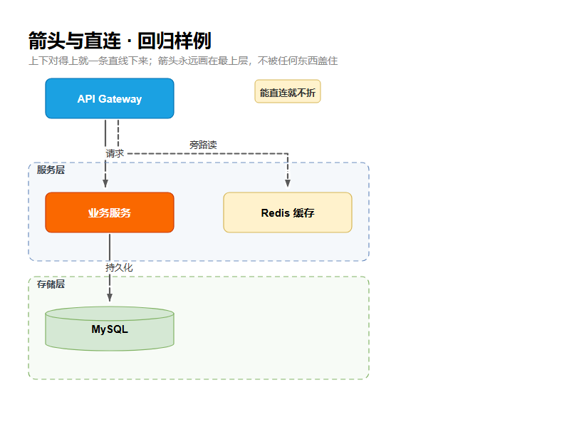

# 刘丹冰Aceld 绘图技能（aceld-diagram）· 架构 / 时序 / 类 / 泳道

刘丹冰Aceld 的 **draw.io 默认主题白底扁平风**绘图技能：圆角矩形模块、圆柱存储、虚线分组、便签标注、细线小箭头、可选跨维度列（放全局/横切模块，非默认）。

把「刘丹冰Aceld 的图怎么画」沉淀成可复用规范 + 零依赖生成器，照着画或自动生成都行。风格提取自其 `鹰眼二期` / `KisFlow` 等 `.drawio` 源文件真实配色与图形。

**支持四种图**：架构图、时序交互图、类图、泳道图。仓库里用同一个 `Zinx` 项目把四种都画了一遍（见下方[图种画廊](#图种画廊四种图同一个-zinx)），配色、字号、标题位置、箭头规则完全一致，可以直接放进同一篇文章。

## 这是什么

一份**风格规范**（`skill/references/style-guide.md`）+ 两个**零依赖 SVG 生成器**：

- `skill/scripts/gen_diagram.py` —— 架构图（节点 / 连线 / 分组 / 便签 / 总线 / 层级）。
- `skill/scripts/gen_diagram_ext.py` —— 扩展图种（时序 / 类 / 泳道），复用主生成器的色板与箭头层，不另立视觉。

想自动出图：写一份 JSON spec，跑生成器，得到 SVG / HTML；想手画或评审：照 style-guide 的清单与反模式执行。

## 快速开始

```bash
# 1) 复制模板
cp skill/assets/diagram.example.json ./my_diagram.json

# 2) 改坐标与字段（nodes / edges / groups / callouts …）

# 3) 生成
python skill/scripts/gen_diagram.py ./my_diagram.json -o my_diagram.html
# 同时产出 my_diagram.html（浏览器直接看）和 my_diagram.svg
```

时序 / 类 / 泳道图走扩展生成器，spec 里多一个 `kind` 字段：

```bash
python skill/scripts/gen_diagram_ext.py examples/zinx_sequence.json \
  -o examples/zinx_sequence.html --svg examples/zinx_sequence.svg
# kind: sequence | class | swimlane
```

无网络、无第三方库即可运行（YAML 才需要 `pyyaml`）。预览 PNG 用无头 Chrome 从 SVG 截图，
只有 `cases/*.png` 入库（`.gitignore` 忽略 `examples/*.png`）。

## 生成时的自检

生成器收尾会打印三类告警，**看到就改，别忽略**：

| 告警 | 含义 | 改法 |
|---|---|---|
| `!! 连线重合 N 处` | 两条线走在同一段路上，看起来像一条粗线或断线 | 调坐标 / 加 `via` / 改用 `buses` |
| `!! 连线穿过节点 N 处` | 线穿过无关盒子，会被盒子整段遮住，只剩箭头悬着 | 改布局（首选）或用 `via` 绕开 |
| `!! 多余折线 N 处` | 能一条直线直达却硬折了一下 | 改坐标 / 删掉 `via` 里的冗余路点 / `straight:true` |

> `kisflow_arch*` / `zinx_arch` / `shorturl_arch` 三份历史案例 spec 会触发「穿节点」告警——这是 2026-11-05 新增诊断查出的**旧布局毛病**，不是生成失败。
> 新画的图按提示改坐标即可；`arrows_regression.json` 回归样例是零告警的。
> 这三类告警只对 `gen_diagram.py` 的架构图生效；扩展图种由 `gen_diagram_ext.py` 自行保证「直连不折 + 箭头置顶」。

## 图种画廊：四种图，同一个 Zinx

同一个项目，四张图讲四件不同的事。**风格是同一套**：纯白底、draw.io 默认调色板、圆角矩形、1px 同色描边、细线小箭头、箭头层置顶、能直连就不折。所以它们能直接排进同一篇文章，不会像四个人画的。

| 图种 | 回答什么问题 | 主要基元 | 生成器 / 可编辑 spec |
|---|---|---|---|
| **① 架构图** | 系统有哪些模块、谁依赖谁、分几层 | 节点 / 连线 / 虚线分组 / 便签 / 跨维度列 | `gen_diagram.py` · [`zinx_arch.json`](examples/zinx_arch.json) |
| **② 时序交互图** | 一次请求按什么顺序穿过组件、谁调用谁、何时返回 | 生命线 / 消息 / 返回虚线 / 激活条 / loop 组合框 | `gen_diagram_ext.py` kind=`sequence` · [`zinx_sequence.json`](examples/zinx_sequence.json) |
| **③ 类图** | 有哪些接口与实现、实现/关联关系怎么走 | 三段式类框（名 / 字段 / 方法）/ 空心三角 / 虚线分组 | `gen_diagram_ext.py` kind=`class` · [`zinx_class.json`](examples/zinx_class.json) |
| **④ 泳道图** | 一个流程跨了哪几个责任方、在谁那里交接 | 泳道 / 序号步骤框 / 跨列折线 | `gen_diagram_ext.py` kind=`swimlane` · [`zinx_swimlane.json`](examples/zinx_swimlane.json) |

> **怎么选**：讲「系统长什么样」用架构图；讲「一次调用怎么走」用时序图；讲「代码里谁实现谁」用类图；讲「流程归谁负责」用泳道图。想用一张图把四件事全讲完，就是「一图一主题」该拆图的信号。

### ① 架构图 · 模块与分层



源 spec：[`examples/zinx_arch.json`](examples/zinx_arch.json)（竖版）。左侧那条纵贯全图的 `接口层` 是**跨维度列**的正确用法：放「贯穿所有模块的通用/横切模块」（接口层 / 监控 / 安全 / 全局配置），按图内容命名，**不是固定的「鹰眼」**。

### ② 时序交互图 · 一次请求的时间线



源 spec：[`examples/zinx_sequence.json`](examples/zinx_sequence.json) · SVG：[`zinx_sequence.svg`](examples/zinx_sequence.svg)

六个参与者横排，实线是调用/数据流、虚线是返回/回写，浅色窄条是激活期，虚线 `loop` 框圈住单个请求包的生命周期。**组合框标题最后落笔**，否则会被生命线和激活条吃掉最后一个字。

### ③ 类图 · 接口与实现



源 spec：[`examples/zinx_class.json`](examples/zinx_class.json) · SVG：[`zinx_class.svg`](examples/zinx_class.svg)

接口在上、实现在中、数据与业务在下，三层用不同浅色的虚线分组框圈开。虚线 + **空心三角**表示实现 `interface`，实线箭头表示关联/依赖；类框沿用同一套圆角矩形与配色 token，字段与方法之间一条细分隔线。

### ④ 泳道图 · 责任分工与交接



源 spec：[`examples/zinx_swimlane.json`](examples/zinx_swimlane.json) · SVG：[`zinx_swimlane.svg`](examples/zinx_swimlane.svg)

四列 = 四个责任层，步骤自上而下编号。**同一层内是一条竖直线**（不折），只有跨层交接才折一次；折线标签落在外侧空白处，序号圆点与步骤框沿用同一色板。

---

## 更多架构图案例

下面都是用 `gen_diagram.py` 画出的架构图（预览为竖版；点开可看高清 PNG 与可编辑 spec）：

### KisFlow 流式计算引擎 · 竖版


源 spec：[`examples/kisflow_arch_portrait.json`](examples/kisflow_arch_portrait.json)（竖版）· [`examples/kisflow_arch.json`](examples/kisflow_arch.json)（横版）

### 短链服务 ShortLink · 竖版（微服务分层）


源 spec：[`examples/shorturl_arch.json`](examples/shorturl_arch.json)

> 版式默认**竖版**（文档高度不限、宽度有限，竖版不被横向裁切）；PPT / 大屏再改坐标出横版。时序 / 类 / 泳道天然是横版，按内容定，不必强行转竖。

### 箭头置顶 + 直连不折 · 回归样例



上下对齐的两盒之间是**一条直线**，不会中途横折一下；三支箭头都画在最上层，节点、分组标题、便签、标签白底都盖不住。改完生成器先跑这份 spec 看效果：[`examples/arrows_regression.json`](examples/arrows_regression.json)。

## 风格速览

| 要素 | 刘丹冰Aceld 的画法 |
|---|---|
| 背景 | 纯白，扁平，无渐变/阴影 |
| 模块 | 圆角矩形，1px 同色描边，中英混排居中 |
| 配色 | draw.io 默认调色板，**同一张图优先全实心重色**（蓝/橙/石板蓝/绿/深红/深灰，白字），深浅不混搭 |
| 存储 | 圆柱（MySQL / Redis / 日志） |
| 分组 | 浅色底 + 虚线圆角框 + 标题（算子池 / 调度核心 / 外部依赖），不同分组不同浅色相 |
| 层级 | 贯穿全图的横向虚线分隔 + 左端加粗层级名/说明（替代零散便签） |
| 标注 | 便签（note）贴一旁 |
| 跨维度列 | 左侧纵贯竖条承载全局/横切模块标签（可选，**非默认**；鹰眼仅鹰眼二期实例） |
| 连线 | ~2.2px 正交小箭头：上下分离竖进竖出、同行并排横进横出；**能直连就一条直线，不折无意义的弯**；主体线画在节点之下（跨盒被遮），**箭头末段单独提到最上层，永不被盖**；同边端口自动错开、跨线白晕留桥、标签自动避让；虚线表控制/依赖 |
| 扩展图种 | 时序的生命线/激活条/组合框、类图的三段式类框/空心三角、泳道的分列步骤框——**基元不同，视觉规则不变**：同一色板、同一字号、标题左上角 26px、箭头层置顶、能直连就不折 |

完整规范、真实配色 token、适用场景与反模式见 [`skill/references/style-guide.md`](skill/references/style-guide.md)。

## 目录结构

```
aceld-diagram/
├── install.sh / install.ps1     一键安装（把 skill/ 拷到技能目录）
├── requirements.txt
├── README.md                    本文件
├── cases/                       成品案例预览图（README 画廊用，入库）
│   ├── kisflow.png / shorturl.png / arrows_regression.png
│   ├── zinx.png                  zinx 架构图
│   ├── zinx_sequence.png         zinx 时序交互图
│   ├── zinx_class.png            zinx 类图
│   └── zinx_swimlane.png         zinx 泳道图
├── skill/
│   ├── SKILL.md                 技能入口
│   ├── references/
│   │   └── style-guide.md       风格提炼 + 配色 + 扩展图种 + 反模式（画前必读）
│   ├── scripts/
│   │   ├── gen_diagram.py       零依赖 SVG 生成器（架构图）
│   │   └── gen_diagram_ext.py   扩展图种生成器（sequence / class / swimlane）
│   └── assets/
│       └── diagram.example.json spec 模板（KisFlow 示例）
└── examples/                    可编辑 spec + 生成结果（json / svg / html）
    ├── kisflow_arch.json / kisflow_arch_portrait.json
    ├── shorturl_arch.json / arrows_regression.json
    ├── zinx_arch.json            ① 架构图
    ├── zinx_sequence.json        ② 时序交互图（kind: sequence）
    ├── zinx_class.json           ③ 类图（kind: class）
    └── zinx_swimlane.json        ④ 泳道图（kind: swimlane）
```

## 安装

### Windows（PowerShell）

```powershell
git clone https://github.com/aceld/aceld-skill.git
cd aceld-skill\aceld-diagram
powershell -ExecutionPolicy Bypass -File .\install.ps1
```

### macOS / Linux

```bash
git clone https://github.com/aceld/aceld-skill.git
cd aceld-skill/aceld-diagram
bash install.sh
```

装完重启会话，对 Agent 说「用刘丹冰Aceld 的风格画一张 XX 架构图」即可。

## 许可

[MIT License](../LICENSE)，可自由用于商业项目。
