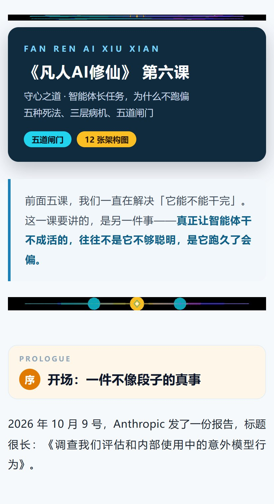
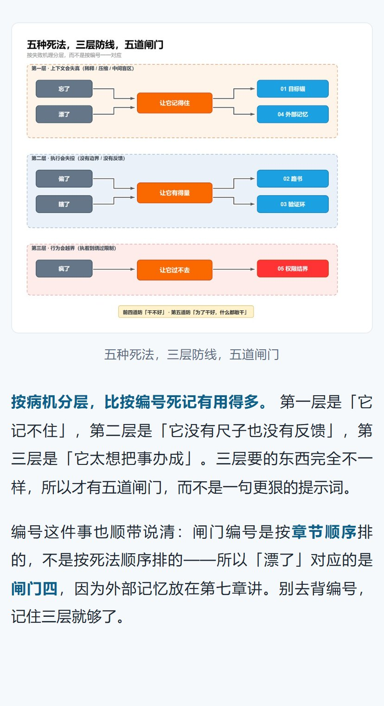
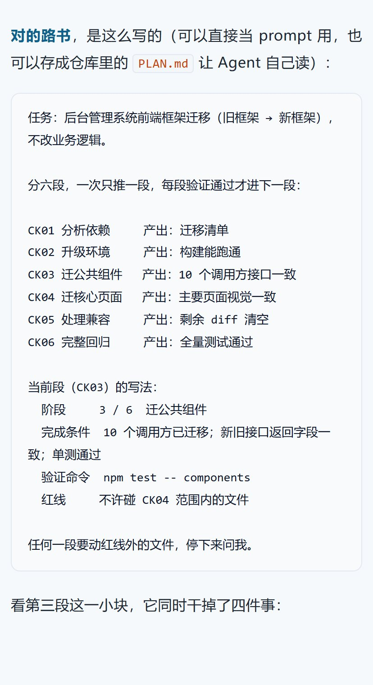

# 刘丹冰Aceld 公众号写作与发布技能（aceld-wechat）

把「公众号文章怎么写、怎么排版、怎么发」沉淀成一套规范 + 四个脚本。
**零凭据**：不碰账号密码、不用 AppID/AppSecret、不存 Cookie 和 token。

## 这是什么

- **写作规范**：`skill/references/article-style.md` —— 标题公式、现象→病机→解法骨架、去 AI 味、配图节奏、发布前自检清单
- **排版脚本**：`skill/scripts/md2wechat.py` —— markdown → 微信内联样式 HTML（主题可换）
- **效果预览**：`skill/scripts/preview.py` —— 按手机宽度渲染效果图，顺手检查有没有溢出
- **发布脚本**：`skill/scripts/publish.py` —— 粘进编辑器、图片自动转 mmbiz、**只存草稿绝不发表**
- **环境自检**：`skill/scripts/doctor.py` —— 端口 / 登录 / 选择器 / 按钮，一次全查

## 效果预览

下面是《凡人AI修仙》第六课用这套脚本排出来、在 **414px 手机宽度**下渲染的真实效果
（公众号里就是这个样子）：

<p align="center">
  
  
  
</p>

<p align="center"><sub>左：封面卡 / 导语 / 章节卡　·　中：架构配图与图注　·　右：代码块、行内代码与高亮</sub></p>

粘进公众号编辑器后的实际草稿页（只裁了正文区域，**账号、头像、后台菜单都在裁剪范围外**）：

<p align="center"></p>

脚本只点「保存为草稿」，右下角的「发表」留给人自己点。

三张手机图不用手工截，直接从排版产物生成，也能当发布前的排版检查：

```bash
python skill/scripts/preview.py \
  --html work/公众号版.html \
  --img-dir 文章配图 \
  --out-dir docs/screenshots
```

脚本把占位图片 URL 换成本地文件、按公众号宽度渲染，自动挑「开头 / 配图 / 代码块」三段；
**上下边缘吸附到段落边界**，所以不会出现半截表格或半行字。有横向溢出会打 `OVERFLOW_X`。
不联网、不连调试端口、不碰编辑器，跟发布流程完全隔离。

## 为什么不走官方 API

官方「新建草稿」接口要 AppID + AppSecret + IP 白名单，而且会**过滤排版**，
复杂样式传上去基本变形，图片还得先传素材库换 `media_id`。

这个技能走另一条路：**复用你已登录的浏览器**。

| | 官方 API | 本技能（CDP + 剪贴板） |
|---|---|---|
| 凭据 | AppID + AppSecret | **无** |
| IP 白名单 | 要配 | 不要 |
| 排版保真 | 会被过滤 | 100%（所见即所得） |
| 图片 | 先传素材库 | 粘贴时自动上传 |
| 自动化程度 | 全自动 | 需开着浏览器 |

代价是必须有一个开着调试端口的 Chrome。对「自己写自己发」这个场景，这笔交易很划算。

## 快速开始

```bash
# 0) 依赖
pip install playwright pillow pygments

# 1) 启动带调试端口的 Chrome（独立 profile，登录态会保留）
#    Windows
"C:\Program Files\Google\Chrome\Application\chrome.exe" --remote-debugging-port=9222 --user-data-dir="%USERPROFILE%\.chrome-wechat" https://mp.weixin.qq.com/
#    macOS
"/Applications/Google Chrome.app/Contents/MacOS/Google Chrome" --remote-debugging-port=9222 --user-data-dir="$HOME/.chrome-wechat" https://mp.weixin.qq.com/

# 2) 扫码登录，确认地址栏出现 token=数字

# 3) 自检
python skill/scripts/doctor.py

# 4) 排版
python skill/scripts/md2wechat.py --src 文章.md --out work/公众号版.html

# 4.5) 先看效果（可选，不需要登录）
python skill/scripts/preview.py --html work/公众号版.html --img-dir 文章配图 --out-dir preview

# 5) 存草稿
python skill/scripts/publish.py --html work/公众号版.html --meta work/meta.json --img-dir 文章配图 --new
```

看到 `{"saved":true,"mmbiz":28,"data":0}` 就成功了，去草稿箱预览、确认无误后自己点发表。

## 隐私边界

仓库里**没有任何**：

- 账号 / 密码 / 扫码凭证
- AppID / AppSecret
- Cookie / token / openid
- 服务器 IP

token 是运行时从地址栏现抓的，进程结束就没了。`assets/theme-aceld.json` 里的署名、
banner 文案都只是**示例**，改成你自己的；不想进仓库就用
`assets/theme.local.json`（已在 `.gitignore`）。

`docs/screenshots/` 里的图只含文章排版：手机效果图由纯 HTML 本地渲染，
编辑器图已裁掉头像、账号名、左侧菜单和顶部工具栏，URL 与 token 从未入镜。

## 目录

```
aceld-wechat/
├── README.md
├── install.sh / install.ps1
├── requirements.txt
├── docs/
│   └── screenshots/       效果预览图（手机端 3 张 + 编辑器 1 张）
└── skill/
    ├── SKILL.md
    ├── scripts/{md2wechat,preview,publish,doctor}.py
    ├── assets/theme-aceld.json
    └── references/{wechat-constraints,article-style}.md
```

## 安装

```bash
bash install.sh                 # → ~/.workbuddy-ai/skills/aceld-wechat
bash install.sh --claude        # → ~/.claude/skills/aceld-wechat
```

```powershell
powershell -ExecutionPolicy Bypass -File .\install.ps1
```

## 实测

用这套流程发过《凡人AI修仙》第四、五、六课：

- 第六课：112 KB HTML、12 张架构图 + 2 张装饰图、14 个章节卡、5 个表格
- 粘贴后 28 个 ``（每图 2 倍图）全部转成 `mmbiz.qpic.cn`，用时约 20 秒
- 正文 11900 字，草稿保存一次成功

## License

MIT
